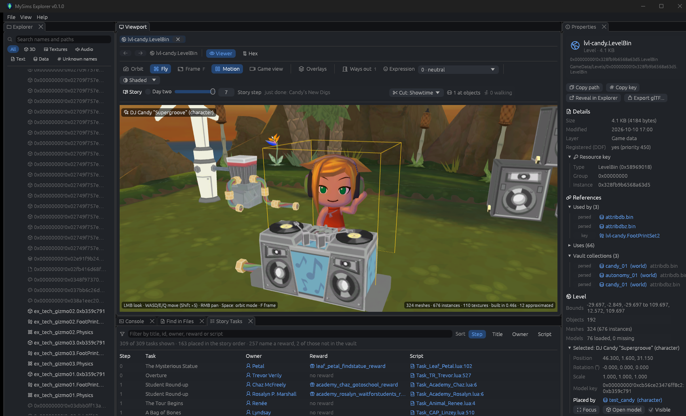
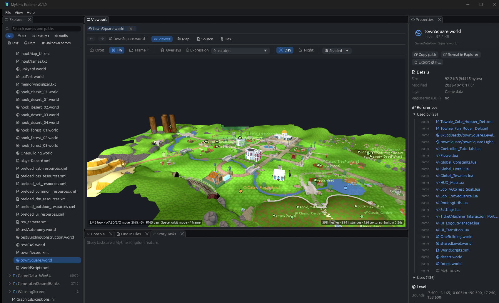
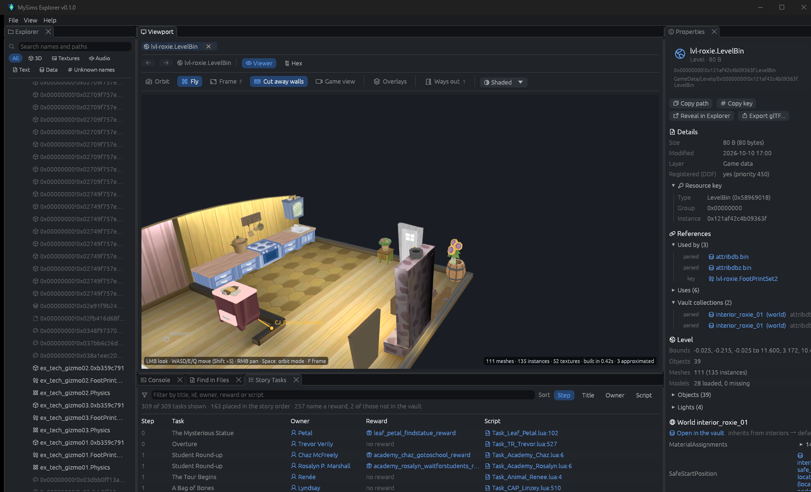
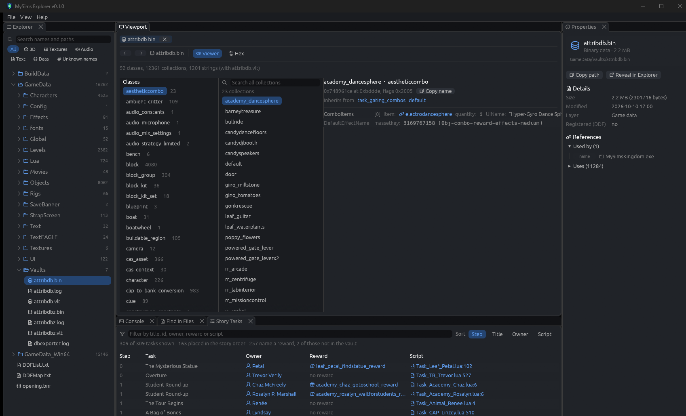

# MySims Explorer

A desktop explorer for **MySims**, **MySims Kingdom** and **MySims Agents**. It opens a game
install and shows its models, levels, textures, materials, strings, scripts, audio and UI, for
finding unused content and other oddities in the game data.

It reads:

- the PC **Cozy Bundle** releases of MySims and MySims Kingdom;
- the older PC release of MySims (the "Taco Bell edition");
- the **Wii** discs of MySims, MySims Kingdom and MySims Agents, extracted with Dolphin.

**It is view only. It never writes to the game's files.**

| | |
|---|---|
|  |  |
| Candypalooza, with DJ Candy at her booth and her cut Showtime block shown | The town square in MySims |
|  |  |
| Roxie's house: an island interior, with its walls cut away | The attribute vault: 92 classes, 12,361 collections, each with what it inherits and refers to |

## What you need

- Windows 10/11. Nothing else to install: from 0.3.0 the programs carry the Visual C++ runtime
  they need inside them.
- A GPU with Direct3D 12, OpenGL or Vulkan support. The program tries them in that order and
  uses the first that starts; **Help → About** says which one it draws with.
- Your own copy of at least one of the games. Nothing from the games is included in this
  download.

Where it finds them:

- **Cozy Bundle:** Steam installs are found on their own, wherever Steam and its library folders
  live.
- **Taco Bell edition:** found where its installer put it (by default
  `C:\Program Files (x86)\Electronic Arts\MySims`).
- **Wii discs:** extract the whole disc with Dolphin (right-click the game → **Properties →
  Filesystem**, right-click the disc → **Extract Entire Disc**), one folder per disc, into a
  `Dumps` folder in your Documents. Every disc there is offered. **File → Wii Dumps Folder** picks
  another folder to look in.

Any other install opens from **File → Open data root**.

## Installing it

1. Download the installer, `mysims-explorer-setup-<version>.exe`, from [Releases](../../releases).
2. Run it, choose a folder, and press Install. Run over an earlier version, it updates that copy
   where it is.

Windows SmartScreen will warn that the program is unrecognised, because the build is not code
signed. **More info → Run anyway.**

It installs for you alone, under `%LOCALAPPDATA%\Programs\MySims Explorer` unless you pick
somewhere else, so it never asks for an administrator. It can add a shortcut to the Start menu
and to the desktop.

To remove it: **Settings → Installed apps**, or `uninstall.exe` in the folder it went to. Only
the files it put there go.

## Running it

Open it from the Start menu, the desktop shortcut, or `mysims-explorer.exe` in the install
folder.

Opening a game for the first time indexes the install and recovers readable names for the hashed
file names, which takes a few seconds. Later runs are quicker.

`mysims-explorer-cli.exe`, beside it, is the same thing for a terminal: `mysims-explorer-cli
root`, `... list fountain`, `... export …`. `mysims-explorer-cli --help` lists the commands.

## Getting around

The app's empty page lists these too.

| | |
|---|---|
| `Ctrl+Shift+F` | Search inside every file |
| Click | Select an object in a 3D view |
| `F` | Frame the selection |
| `Space` | Orbit or fly |
| Middle click | Pause or resume what moves in a 3D view |
| Properties | What a file uses, and what uses it (click to follow) |

In MySims Kingdom, a level shows its characters where the story puts them: the **Story strip**
picks a step, and double-clicking a building goes inside at the same step.

**Cutscenes** play in the level they happen in: **View → Story → Cutscenes → Play**, or the **Play
it** button on any `Cutscene*.lua`. The cast stands where the script puts them and plays its
animations, the camera takes the script's shots, the dialog is captioned over the view, and the
sounds and effects play. The strip under the toolbar plays, holds and scrubs it; **Hold each line**
stops at the end of every dialog line until you press Enter, the way the game waits for a click. A
cutscene is played from what its script says rather than by running the game, so a line's length
(unless held), the routes walked and values the script works out while running are approximations.

**Saving a file in the game folder shows it at once.** The program watches the folder it opened:
the file you're looking at (or one it was built from) opens again where you were, a cutscene
replays from the same moment, and a new file joins the file list. A cutscene script saved
half-written says which line breaks it, and a cutscene's strip lists the problems in its script by
line. The program itself still never writes to the folder.

The viewer shows one file at a time: **Back** and **Forward** (`Alt+←` / `Alt+→`, or the mouse's
side buttons) move through what you have opened.

### The Wii discs

The Wii discs open like the PC releases: their models, textures, materials, levels and worlds
draw in 3D, characters are built and play their animations, the sound banks and streams play, and
the Content tab works on them, as does the Story panel's list of Kingdom's tasks. MySims Agents had no PC release, so this is a
way to look inside it.

Their **scripts** are compiled. They open decompiled, as readable Lua, and Find in Files and the
links between files read that text. MySims packs all of its scripts into seven large files; the
Explorer lists the scripts each one holds by name (search finds them too), and opening one shows
just that script. A few pieces of code can't be put back into Lua and are shown as a commented
list of instructions instead.

Some of the Wii's shader effects (the gloss on Sims, some water, a few of Agents' own materials)
are drawn approximately.

### Names

Most files are named by a hash rather than a name, and the names are recovered from the game's
own text where they can be. **File → Hash List** takes names from a hash list as well, which
names thousands more: in MySims Kingdom, 27,546 of its 31,413 files against 21,526 without one.
The lists live at [ThuverX/mysims-hashlist](https://github.com/ThuverX/mysims-hashlist). Take
the one for the game you are opening, and point the app at it.

### Updates

On start it asks GitHub once whether a newer release exists. If there is one, it downloads that
release's installer in the background and, once the download checks out, offers **Restart to
update** under the menu bar: the program closes, updates where it is, and opens again. The
installer is only run when it carries the release signature, so nothing from elsewhere is ever
installed. **Help → Check for updates** turns all of this off. After an update it shows what
changed, from the release's own notes.

## What it does not do

- **It never writes to the game folder.** There is no editor, no save-file support and no mod
  tooling, by design.
- **It ships no game content.** You need your own install; nothing from the games is
  redistributed here.
- **Only the releases listed at the top are supported.** The Origin and other older PC releases
  are not, nor are other platforms.
- Many formats are read only in part. Where a field's meaning is unknown it is shown as unknown
  rather than guessed at.

## Reporting a problem

Open an issue on this repository, or report it in the [MySims Clubhouse Discord](https://discord.gg/2j9mU6zNJH).

Please include:

- The version, from **Help → About**.
- Which game, and which file you opened.
- What the **Console** panel says (View → Console), copied out.

## Terms

Pass the software around as you like; it comes with no warranty. This is an unofficial fan tool
not made or endorsed by Electronic Arts and it contains no game assets, code or other content.
